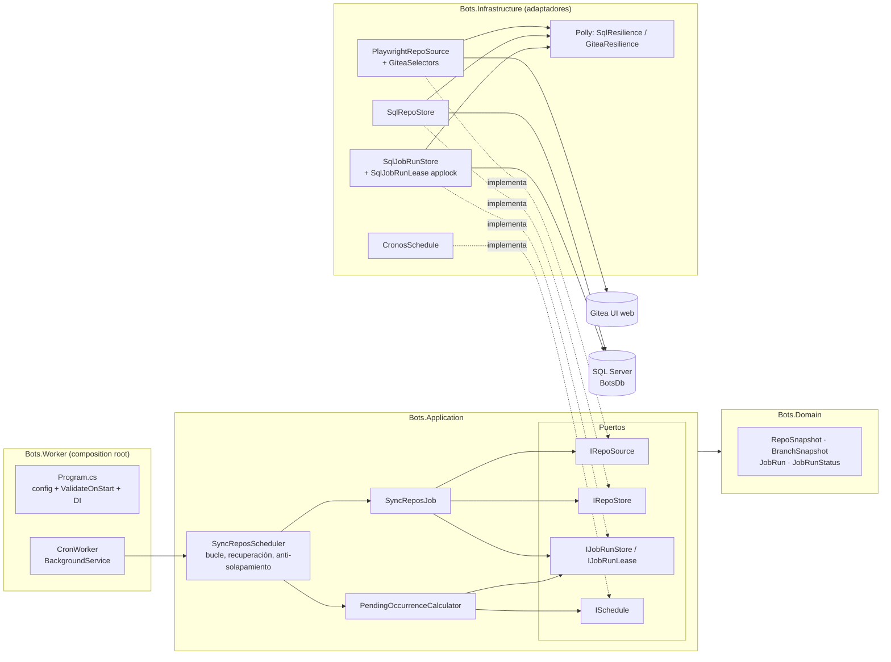

# Blueprint: bot de sincronización de repos

Diseño de la PoC que reemplaza un flujo de Power Automate por un bot mantenible. Criterio de negocio:
**la omisión (no procesar un repo o una corrida) es lo peor; el duplicado también es grave.**

## Arquitectura hexagonal

Reglas de dependencias: Domain no depende de nada; Application solo de Domain y
`Microsoft.Extensions.Logging.Abstractions` (no conoce Cronos, Dapper ni Playwright); Infrastructure
implementa los puertos; Worker es el único composition root. Toda la lógica con comportamiento no trivial
(incluido el bucle de programación) vive en Application o Infrastructure, donde se prueba; Worker es una
capa delgada.

## Puertos y adaptadores

| Puerto (Application) | Adaptador (Infrastructure) | Notas |
|---|---|---|
| `IRepoSource` | `PlaywrightRepoSource` | Listado (`ListRepoKeysAsync`, fallo = fatal) separado del detalle (`GetRepoAsync`, fallo = solo ese repo). Selectores en `GiteaSelectors`. |
| `IRepoStore` | `SqlRepoStore` | Upsert atómico por repo: MERGE del repo + MERGE de ramas (OPENJSON) + borrado de ramas que ya no existen, en una transacción. |
| `IJobRunStore` / `IJobRunLease` | `SqlJobRunStore` / `SqlJobRunLease` | Reglas de `TryStartAsync` con `sp_getapplock` de sesión; el lease mantiene el lock toda la corrida. |
| `ISchedule` | `CronosSchedule` | Cron de 5 campos evaluado en la zona configurada; ocurrencias en UTC. |

## Garantías contra omisión y duplicado

| Riesgo | Mecanismo |
|---|---|
| Corrida duplicada | `UNIQUE (job_name, scheduled_for_utc)` en `bots.job_runs`: una fila por ocurrencia. Reintentos reutilizan la fila (`attempt + 1`). |
| Dos instancias a la vez | `sp_getapplock` exclusivo de sesión (timeout 0) por job, en una conexión dedicada sin pool que mantiene el lease; la otra instancia recibe `null` y lo registra. |
| Cierre de una corrida ajena | `CompleteAsync` solo actualiza si coinciden `id`, `attempt` y estado `Running` (o el mismo estado final, para que un reintento sea seguro). |
| Reintento tras perder la respuesta de un COMMIT | `TryStartAsync` y `AddErrorAsync` generan una clave por llamada lógica (`job_runs.start_token`, `job_run_errors.idempotency_key`, V3) que se repite en cada reintento de Polly: el reintento adopta su propia fila en vez de gastar un intento, y el error no se duplica. |
| Datos duplicados | Upserts idempotentes (MERGE con `HOLDLOCK`); ejecutar dos veces deja el mismo estado. |
| Ocurrencia perdida por caída | Al arrancar y en cada despertar se calcula la ocurrencia pendiente (`PendingOccurrenceCalculator`): la más reciente después de la última completada. Como el job sincroniza el estado completo, basta con ejecutar esa; las demás se registran (Warning). |
| Proceso muerto a mitad | La fila queda `Running`; al retomarla con el lock libre se marca `Abandoned` y se reintenta la **misma** ocurrencia con `attempt + 1`. `MarkStaleRunsAbandonedAsync` limpia las huérfanas antiguas (solo si obtiene el lock). |
| Bucle de reinicios | `MaxAttempts` (default 3) por ocurrencia: agotados, no se retoma y se registra un Error. |
| Apagado (`docker stop`) | El `CancellationToken` cierra la página de Playwright; la corrida queda `Abandoned` ("Cancelada por apagado ordenado") y se retoma al arrancar. `ShutdownTimeout` 45 s < `stop_grace_period` 60 s. |
| Repo omitido en silencio | El listado de repos y el de ramas se cotejan con los contadores que muestra Gitea; si no cuadran, falla (`GiteaInconsistentDataException`). 0 repos = `Failed` salvo `AllowEmptySource`. |
| Fallo de un repo | No aborta los demás: se registra en `job_run_errors` y la corrida queda `PartiallyFailed` (cuenta como completada; el repo se reprocesa en la siguiente). |
| Auditoría | `job_run_errors` guarda cada error con su `attempt`; al retomar, el cierre del intento anterior (estado y resumen) se registra allí antes de limpiar la fila. |

## Resiliencia (Polly v8)

Reintento con backoff exponencial + jitter y, dentro, circuit breaker; configurables en
`Bots:Resilience:Sql` y `Bots:Resilience:Gitea`. Solo actúan sobre errores **transitorios**:

| Transitorios (se reintentan) | No transitorios (fallan sin reintentar) |
|---|---|
| SQL: timeout (-2), deadlock (1205), cortes de red (64, 233, 10053, 10054, 10060), BD no disponible (4060), errores típicos de Azure SQL (40197, 40501, 40613, 49918-49920…); `TimeoutException` | SQL: login fallido (18456), permisos (229, 262), sintaxis, violación de UNIQUE (2627, 2601) |
| Gitea: timeouts de Playwright, `net::ERR_*`, HTTP 5xx y 429, sesión expirada (vuelve a iniciar sesión) | Gitea: credenciales inválidas, 2FA, selector no encontrado, datos inconsistentes, 404, redirección a otro origen |

## Decisiones y alternativas descartadas

| Decisión | Alternativa descartada | Motivo |
|---|---|---|
| Cronos dentro de un `BackgroundService` | Quartz.NET | Un solo job: Quartz añade su propio almacén, clustering y configuración que aquí no aportan; la idempotencia y el lock ya los resuelve la BD. |
| Dapper + SQL explícito | EF Core | SQL visible y auditable (MERGE, applock, guardas), sin migraciones de EF (las hace Flyway) ni un modelo de cambios que no se necesita. |
| .NET 10 | Python | Stack del equipo, tipado, Worker Services y la misma imagen Playwright soportada oficialmente. |
| RPA sobre la UI (Playwright) | API REST de Gitea | El objetivo es automatizar sitios sin API oficial. Verificado en Gitea 28.2 que el conteo de commits por rama de la UI coincide con `git rev-list --count`. |
| Ramas como JSON (`OPENJSON`) | Tipo tabla (TVP) | Evita crear un tipo en la BD (otra migración). Requiere nivel de compatibilidad ≥ 130 (SQL Server 2022 y Azure SQL lo cumplen). |
| Fechas `DATETIME2(3)` UTC, parámetros declarados como `DateTime2` | `DATETIMEOFFSET` | Dapper enviaría `DATETIME` (pierde precisión) o `DATETIMEOFFSET` (obliga a convertir la columna e impide usar el índice de la clave anti-duplicado). |
| `branch_name` con collation binaria | Collation por defecto (CI) | Git distingue mayúsculas: `Main` y `main` son ramas distintas. `external_key` sí es CI porque Gitea no distingue mayúsculas en owner/repo. |
| Bucle de programación en Application | Lógica en el Worker | No hay `Worker.Tests`: el bucle se prueba con `FakeTimeProvider`. |
| Publish framework-dependent | Self-contained | La imagen `mcr.microsoft.com/playwright/dotnet:v1.63.0-noble` trae .NET 10 (verificado: runtime 10.0.12). |
| Cancelación = `Abandoned` | `Failed` | Distingue un apagado de un error en el runbook; ambos se reintentan. Gasta un intento (ver límites). |
| `README.md` sin distinguir mayúsculas | Nombre exacto | Gitea muestra `README.MD` como README del repo. |

### Imagen y versiones

El tag de la imagen base del target `runtime` (`PLAYWRIGHT_TAG` en el Dockerfile) debe coincidir con la
versión del paquete `Microsoft.Playwright` de `Directory.Packages.props`: el driver del paquete busca los
navegadores de su misma versión en `/ms-playwright`. Para actualizar, cambiar ambos a la vez y reconstruir.
El parche del runtime .NET de la imagen lo controla Microsoft (hoy 10.0.12, por debajo de los paquetes
10.0.13): revisar al subir de versión. El Dockerfile da permiso de ejecución al driver (`chmod +x`),
porque NuGet no lo conserva.

## Límites conocidos de la PoC

- **Conexión del lock inactiva.** El applock vive en una conexión abierta durante toda la corrida. Un
  corte de red o un timeout de inactividad (balanceadores, gateway de Azure SQL) termina la sesión y libera
  el lock sin aviso; otra instancia podría tomarlo. El UNIQUE y la guarda de `CompleteAsync` evitan filas
  duplicadas, pero dos instancias podrían escribir los mismos repos a la vez (upserts idempotentes). **Riesgo
  a revisar al ir a Azure** (opciones: lease con expiración en tabla renovado por latido, o una única
  réplica del job).
- **Primera ocurrencia fallida.** Sin ninguna corrida completada no hay "historial": si la primera
  ocurrencia falla no se reintenta; se ejecuta la siguiente (el estado se sincroniza completo).
- **Cancelaciones gastan intentos.** Tres `docker stop` sobre la misma ocurrencia agotan `MaxAttempts`; la
  siguiente ocurrencia sincroniza los datos igualmente.
- **Dependencia del HTML de Gitea.** Selectores verificados contra Gitea 28.2 (con sesión, idioma del
  usuario en español). Un cambio de versión puede romperlos: el bot falla de forma explícita y, si se
  configura `Gitea:DiagnosticsDirectory`, guarda el HTML de la página.
- **Caché de Gitea.** Gitea cachea el conteo de commits por rama y lo invalida al hacer push; no se probó
  explícitamente un push seguido de una lectura inmediata.
- **Una instancia, corridas secuenciales.** Pensado para un solo contenedor; la segunda instancia solo
  espera (no reparte trabajo).
- **TrustServerCertificate** solo en el SQL Server local (certificado autofirmado). Flyway usa lo mismo en
  local.
- **Login sin 2FA.** Si Gitea pide segundo factor, el bot falla con `GiteaLoginException`.

## Ruta hacia Azure (no implementada)

- **Ejecución:** Azure Container Apps (job programado o réplica única) o AKS; imagen en Azure Container
  Registry construida por Azure DevOps.
- **Datos:** Azure SQL Database; validar certificado (`TrustServerCertificate=false`), revisar el riesgo
  del lock de sesión (ver límites) y los códigos transitorios de Azure ya incluidos.
- **Secretos e identidad:** Azure Key Vault y Managed Identity (autenticación Entra ID a Azure SQL en vez
  de usuario/contraseña).
- **Migraciones:** Flyway en un paso del pipeline de Azure DevOps contra cada entorno.
- **Observabilidad:** los logs JSON a stdout se recogen en Log Analytics; alertas sobre `Failed`,
  intentos agotados y circuit breaker abierto.
- **Red:** acceso privado al sitio objetivo y a Azure SQL (VNet / private endpoints).
